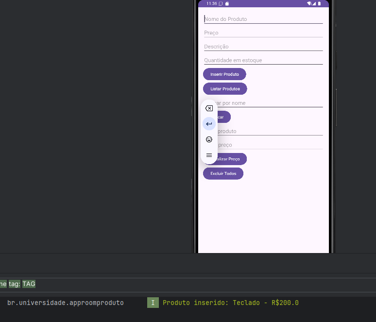
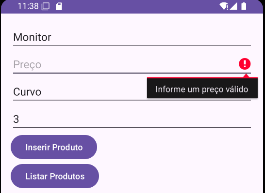
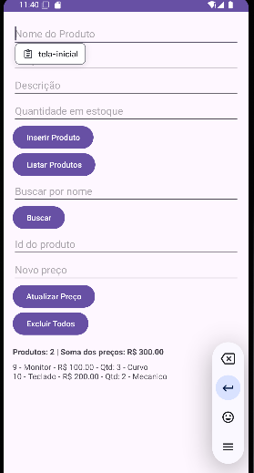
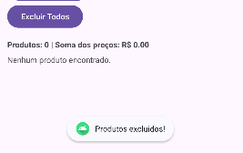
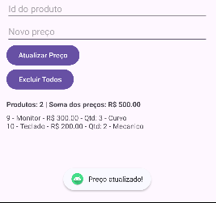
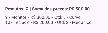

# AppRoomProduto: Cadastro de Produtos com Room SQLite

**Aluno(a):** Maria Clara Santana Vianna
**RA:** 243911
**Aluno(a):** Yasmin Araújo de Barros
**RA:** 219607
**Disciplina:** DESENVOLVIMENTO PARA DISPOSITIVOS MÓVEIS
**Professor(a):** ALESSANDRO FERREIRA PAZ LIMA

## Sobre o projeto

Aplicativo Android em Kotlin que cadastra e lista produtos usando persistência local com Room (SQLite).

## Tecnologias

- Kotlin
- Room 2.6.1 (SQLite)
- ViewBinding
- Corrotinas (lifecycleScope)

## Parte A: Complemento prático

### A1. Limpar campos após inserir
O que foi feito: depois de inserir o produto com sucesso, os campos são apagados com `text.clear()` e o cursor volta para o campo Nome com `requestFocus()`.

Trecho de código:
```kotlin
binding.editProductName.text.clear()
binding.editProductPrice.text.clear()
binding.editProductDescription.text.clear()
binding.editProductQuantity.text.clear()
binding.editProductName.requestFocus()
```
Print: 

### A2. Validação de preço
O que foi feito: o preço é convertido com `toDoubleOrNull()`. Se estiver vazio, inválido, zero ou negativo, o produto não é salvo e o erro aparece no próprio campo.

Trecho de código:
```kotlin
val price = priceText.toDoubleOrNull()
if (price == null || price <= 0.0) {
    binding.editProductPrice.error = "Informe um preço válido"
    return@setOnClickListener
}
```
Print: 

### A3. Lista na tela
O que foi feito: foi adicionado um `TextView` (`txtLista`) abaixo dos botões. Ao clicar em Listar Produtos, os produtos são mostrados nele, além do Logcat.

Trecho de código:
```kotlin
private fun mostrarProdutos(products: List<Product>) {
    binding.txtLista.text = if (products.isEmpty()) {
        "Nenhum produto encontrado."
    } else {
        products.joinToString("\n") {
            "${it.id} - ${it.name} - R$ ${"%.2f".format(it.price)} - Qtd: ${it.quantity} - ${it.description}"
        }
    }
    // ...
}
```
Print: 

### A4. Total do estoque
O que foi feito: junto da lista, um `TextView` (`txtTotal`) mostra a quantidade de produtos cadastrados e a soma dos preços.

Trecho de código:
```kotlin
binding.txtTotal.text =
    "Produtos: ${products.size} | Soma dos preços: R$ ${"%.2f".format(products.sumOf { it.price })}"
```
Print: 

### A5. Buscar por nome
O que foi feito: foi criada a função `buscarPorNome` no DAO, um campo de busca (`editBuscar`) e o botão Buscar. O texto é envolvido por `%` para encontrar nomes parecidos.

Trecho de código:
```kotlin
// ProductDao.kt
@Query("SELECT * FROM product WHERE name LIKE :nome")
suspend fun buscarPorNome(nome: String): List<Product>

// MainActivity.kt
mostrarProdutos(productDao.buscarPorNome("%$texto%"))
```
Print: 

### A6. Excluir produtos
O que foi feito: foi criada a função `deleteAll()` no DAO e o botão Excluir Todos, que apaga todos os produtos e limpa a lista na tela.

Trecho de código:
```kotlin
// ProductDao.kt
@Query("DELETE FROM product")
suspend fun deleteAll()

// MainActivity.kt
productDao.deleteAll()
```
Print: 

### A7. Atualizar produto
O que foi feito: o usuário informa o id e o novo preço e clica em Atualizar Preço. O produto é buscado com `getById`, copiado com o novo preço e salvo com `@Update`.

Trecho de código:
```kotlin
// ProductDao.kt
@Query("SELECT * FROM product WHERE id = :id")
suspend fun getById(id: Int): Product?

@Update
suspend fun update(product: Product)

// MainActivity.kt
productDao.update(product.copy(price = newPrice))
```
Print: 

### A8. Novo campo na tabela: quantity
O que foi feito: foi adicionado `quantity: Int` na entidade `Product`, o campo "Quantidade em estoque" no layout e o `version` do `@Database` passou para 2.

Trecho de código:
```kotlin
// Product.kt
@ColumnInfo(name = "quantity") val quantity: Int

// AppDatabase.kt
@Database(entities = [Product::class], version = 2)
```

O que aconteceu com os produtos já cadastrados e por quê: eles foram apagados. O Room compara a versão do banco salvo no aparelho (1) com a do código (2). Como a estrutura da tabela mudou e não existe uma `Migration` que ensine o Room a converter os dados, o `fallbackToDestructiveMigration()` apaga as tabelas antigas e cria o banco novamente já com a coluna `quantity`. Por isso a lista começou vazia após a mudança.

Print: 

---

## Parte B: Questões dissertativas

### B1. O que é persistência de dados? O que aconteceria com os produtos se fossem guardados apenas em uma MutableList dentro da MainActivity?

**Resposta:** Persistência de dados é a capacidade de um aplicativo guardar informações de forma duradoura, de modo que elas continuem existindo depois que o app é fechado, o celular é reiniciado ou o processo é encerrado pelo sistema. No meu projeto, quando clico em "Inserir Produto", o Room grava o produto em um arquivo SQLite no armazenamento interno do aparelho (o arquivo `database-name`). Por isso, ao fechar o app e abrir de novo, o botão "Listar Produtos" ainda mostra tudo o que foi cadastrado. Se eu usasse apenas uma `MutableList` dentro da `MainActivity`, os produtos ficariam somente na memória RAM, que é temporária. Bastaria fechar o app, o Android encerrar o processo para liberar memória ou até girar a tela (a Activity é recriada e a lista volta vazia) para que todos os produtos fossem perdidos. Ou seja, a lista funcionaria só enquanto o app estivesse aberto, o que não serve para um cadastro de verdade, em que o usuário espera que os dados continuem lá no dia seguinte.

### B2. Qual é a diferença entre usar o SQLite diretamente e usar o Room? Cite pelo menos duas vantagens do Room.

**Resposta:** Ao usar o SQLite diretamente, preciso criar uma classe que herda de `SQLiteOpenHelper`, escrever na mão os comandos SQL em strings (como o `CREATE TABLE`), montar `ContentValues` para inserir dados e percorrer um `Cursor` coluna por coluna para transformar o resultado em objetos Kotlin. É muito código repetitivo e, como tudo é texto, um erro de digitação em um nome de coluna só aparece quando o app já está rodando e quebra. O Room é uma camada por cima do SQLite que automatiza grande parte desse trabalho. Uma primeira vantagem é a verificação em tempo de compilação: se eu errar o SQL de um `@Query` ou o nome de uma coluna, o erro aparece no build, antes de rodar o app. Uma segunda vantagem é a redução de código repetitivo: com `@Entity`, `@Dao` e `@Insert`, o Room gera sozinho o `INSERT` e converte as linhas do banco em objetos `Product`, sem eu mexer em `Cursor`. Outra vantagem é o suporte nativo a corrotinas (`suspend`), que facilita fazer o acesso ao banco fora da thread principal, e o suporte a migrações, que ajuda a atualizar a estrutura do banco com segurança. No fim, o Room continua usando SQLite por baixo, mas com um código mais curto, mais seguro e mais fácil de manter.

### B3. Explique o papel de Entity, DAO e Database. Como elas se relacionam no seu projeto?

**Resposta:** A Entity é a classe que representa uma tabela do banco. No projeto, `Product` está anotada com `@Entity`, e cada atributo (`id`, `name`, `price`, `description`) vira uma coluna; o `id` é a chave primária com geração automática. O DAO (Data Access Object) é a interface que define as operações que posso fazer nessa tabela. No meu `ProductDao`, tenho o `getAll()`, com um `@Query("SELECT * FROM product")`, e o `insertAll()`, com `@Insert`; o Room escreve a implementação dessas funções para mim. A Database é a classe abstrata `AppDatabase`, anotada com `@Database(entities = [Product::class], version = 1)`, que junta tudo: ela informa ao Room quais entidades existem, qual a versão do banco e expõe o DAO por meio da função `productDao()`. A relação é uma cadeia: a `MainActivity` constrói o `AppDatabase` com `Room.databaseBuilder`, pede a ele o `ProductDao` e chama as funções do DAO, que trabalham com objetos `Product`, os quais por sua vez correspondem às linhas da tabela `product` no arquivo SQLite.

### B4. Por que o Android não permite acessar o banco na thread principal? O que é um ANR? Como `suspend` e `lifecycleScope.launch` resolvem esse problema?

**Resposta:** A thread principal (UI thread) é a responsável por desenhar a tela e responder aos toques do usuário. Ler ou gravar em disco é uma operação lenta e, se ela for feita nessa thread, a interface fica congelada até terminar, causando travadas. Por isso o Room bloqueia consultas na thread principal e lança o erro "Cannot access database on the main thread". O ANR (Application Not Responding) é o aviso que o Android mostra quando a thread principal fica bloqueada por tempo demais (em torno de 5 segundos) sem responder; o sistema oferece ao usuário fechar o app, o que é uma experiência ruim. No meu projeto, as funções do DAO são marcadas com `suspend`, o que permite ao Room executá-las em uma thread de segundo plano e devolver o resultado depois, sem bloquear a tela. Já o `lifecycleScope.launch { }` abre uma corrotina ligada ao ciclo de vida da Activity: eu consigo chamar `productDao.getAll()` de forma sequencial no código, e a interface continua fluida enquanto o banco trabalha. Além disso, se a Activity for destruída, a corrotina é cancelada automaticamente, evitando trabalho desnecessário e vazamento de memória.

### B5. O que faz o `fallbackToDestructiveMigration()`? Por que ele é perigoso em um app publicado? O que seria uma migração?

**Resposta:** Quando altero a estrutura de uma entidade (por exemplo, adiciono uma coluna) e aumento o `version` do banco, o Room precisa saber como transformar o banco antigo no novo. O `fallbackToDestructiveMigration()` resolve isso do jeito mais simples e brutal: se não existir uma migração definida, ele apaga o banco inteiro e cria um novo, vazio, com a estrutura atual. Durante o desenvolvimento isso é conveniente, porque os dados são apenas de teste. Em um app publicado na Play Store, porém, é perigoso, porque cada usuário que atualizasse o app perderia todos os seus dados cadastrados, sem aviso, o que seria um problema grave de confiança e até de prejuízo, como perder o estoque de uma loja. Uma migração (`Migration`) é justamente o caminho correto: uma classe em que eu informo a versão de origem, a versão de destino e os comandos SQL necessários para alterar o banco preservando os dados. Por exemplo, `Migration(1, 2)` poderia executar `ALTER TABLE product ADD COLUMN quantity INTEGER NOT NULL DEFAULT 0`, e os produtos antigos continuariam existindo, só ganhariam a nova coluna com um valor padrão.

### B6. Qual é a vantagem do ViewBinding em relação ao `findViewById`? Que tipo de erro ele ajuda a evitar?

**Resposta:** Com `findViewById`, preciso procurar cada componente pelo seu id a cada vez, e o resultado vem como um `View` genérico que muitas vezes exige conversão de tipo. Se eu errar o id, ou se o componente não existir naquele layout, o problema só aparece em tempo de execução, como um app que fecha com `NullPointerException` ou `ClassCastException`. O ViewBinding gera automaticamente uma classe (no projeto, `ActivityMainBinding`) com uma propriedade para cada componente que tem id no XML, já com o tipo correto. Assim escrevo `binding.editProductName.text` e o Android Studio sabe que aquilo é um `EditText`, com autocompletar e verificação. Se eu remover ou renomear um id no layout e esquecer de atualizar o código, o erro acontece na compilação, não na frente do usuário. Ele também evita erros de tipo e referências a views de outro layout, além de deixar o código mais curto e legível, sem chamadas repetidas de `findViewById`.

### B7. Por que em apps maiores é recomendado criar o banco como Singleton? O que poderia acontecer se várias telas criassem cada uma o seu banco?

**Resposta:** No tutorial o banco é criado dentro da `MainActivity`, o que funciona bem porque o app tem uma única tela. Em apps maiores, no entanto, criar uma instância do `AppDatabase` em cada tela seria um desperdício e fonte de problemas. Cada instância abre as suas próprias conexões com o arquivo do banco e mantém seus próprios recursos em memória, e o Room é considerado um objeto "pesado" de criar. Pior do que isso, várias instâncias acessando o mesmo arquivo podem gerar concorrência e bloqueios de escrita, e cada uma teria o seu sistema de notificação de mudanças separado, de modo que uma tela poderia não ser avisada quando outra inserisse dados, causando informações desatualizadas ou inconsistentes. O padrão Singleton garante uma única instância para o app inteiro, normalmente com um `companion object` que guarda o banco em uma variável `@Volatile` e cria a instância dentro de um bloco `synchronized` na primeira vez que ela é pedida. Todas as telas então reutilizam o mesmo banco, com menos consumo de memória e dados consistentes. Em projetos maiores isso costuma ser feito também com injeção de dependências, como o Hilt.

### B8. Reflexão pessoal: principais dificuldades e um app real em que o Room seria útil

**Resposta:** A primeira dificuldade que tive foi na configuração do projeto: depois de adicionar o `kapt` e as dependências do Room no `build.gradle.kts`, precisei sincronizar o Gradle e depois fazer um Rebuild para que a classe `ActivityMainBinding` fosse reconhecida, o que resolveu o erro "Unresolved reference". Outra dificuldade foi entender por que as funções do DAO precisam ser `suspend` e por que o acesso ao banco precisa ficar dentro de `lifecycleScope.launch`; só entendi de fato quando li a mensagem "Cannot access database on the main thread" e relacionei com a ideia de não travar a tela. Também demorei a entender como as três peças (Entity, DAO e Database) se conectam, e o que me ajudou foi seguir o caminho do dado desde o clique no botão até a tabela. Um app real em que o Room seria muito útil é um aplicativo de controle de estoque para uma pequena loja de bairro. O dono poderia cadastrar produtos com nome, preço e quantidade, consultar o que ainda tem disponível e atualizar o estoque a cada venda, tudo guardado no próprio celular e funcionando mesmo sem internet. Eu aplicaria uma entidade `Produto` e outra `Venda`, com DAOs para busca por nome, atualização de quantidade e relatório do total em estoque, e usaria migrações para evoluir o banco sem perder o histórico da loja.

---

## Como executar

1. Clone o repositório
2. Abra no Android Studio
3. Execute em um emulador (API 24+)
